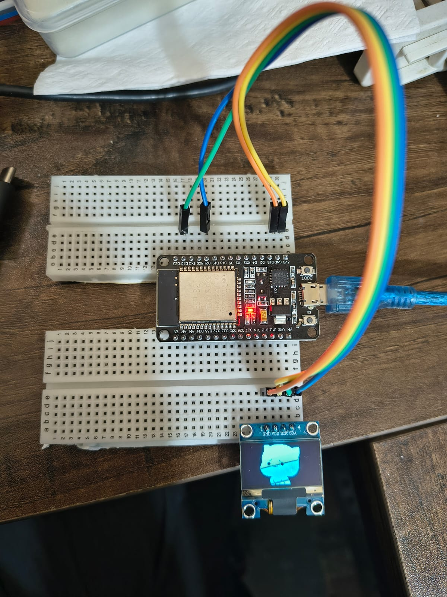

# ESP32 OLED GIF Player

Play any GIF as a looping animation on a 128×64 SSD1306 OLED, driven by an ESP32.
Includes a small Python tool (`gif2oled.py`) that converts a GIF into a C header of 1‑bit
frames, and an Arduino sketch that plays them from flash.



## Features

- Convert any GIF/image → 1‑bit frames for a 128×64 OLED.
- Two render styles: **threshold** (bold black/white) or **dither** (halftone).
- **crop** to fill the screen or **fit** (letterbox) the whole frame.
- Keep only the last N frames (`--keep-last`) to trim long clips.
- Frames stored in `PROGMEM` (flash), so even classic ESP32s with little RAM play long clips.

## Hardware

| Part | Model |
|------|-------|
| MCU | ESP32 DevKit — ESP32‑WROOM‑32 (e.g. ESP32‑D0WD‑V3), 4 MB flash |
| Display | 0.96″ OLED, **SSD1306** driver, 128×64, I²C (4‑pin) |
| Wires | 4 × female‑female jumper |

> A 1.3″ OLED usually uses the **SH1106** driver instead — use the `Adafruit_SH110X` library if so.

### Wiring (I²C)

| ESP32 | OLED (SSD1306) |
|-------|----------------|
| 3V3   | VCC |
| GND   | GND |
| GPIO21| SDA |
| GPIO22| SCL |

Check your module's silkscreen — some list the pins as `GND VCC SCL SDA`. Default I²C address is `0x3C` (some are `0x3D`).

## 1. Convert a GIF

```bash
pip install -r requirements.txt
python gif2oled.py input.gif -o firmware/oled_gif/frames.h
```

Options:

| Flag | Default | Description |
|------|---------|-------------|
| `--mode` | `threshold` | `threshold` (bold B/W) or `dither` (halftone) |
| `--fit` | `crop` | `crop` (fill screen) or `fit` (letterbox whole frame) |
| `--keep-last N` | `0` (all) | keep only the last N frames (trims a long clip's start) |
| `--fps N` | `15` | playback speed |
| `--width` / `--height` | `128` / `64` | target resolution |

Example — trim a long clip to its last 100 frames, bold style, fill the screen:

```bash
python gif2oled.py clip.gif -o firmware/oled_gif/frames.h --mode threshold --fit crop --keep-last 100 --fps 15
```

## 2. Build

Install the toolchain once:

```bash
arduino-cli core install esp32:esp32
arduino-cli lib install "Adafruit SSD1306"
```

Compile (produces a merged binary for esptool):

```bash
arduino-cli compile --fqbn esp32:esp32:esp32 --export-binaries firmware/oled_gif
```

Prefer a GUI? Open `firmware/oled_gif/oled_gif.ino` in the Arduino IDE, select an ESP32 board, and upload — no esptool needed.

## 3. Flash with esptool

```bash
pip install esptool
```

**Windows** (replace `COM6` with your port):

```bat
esptool --chip esp32 -p COM6 -b 460800 write-flash 0x0 firmware\oled_gif\build\esp32.esp32.esp32\oled_gif.ino.merged.bin
```

**Linux / macOS** (replace `/dev/ttyUSB0`):

```bash
esptool --chip esp32 -p /dev/ttyUSB0 -b 460800 write-flash 0x0 firmware/oled_gif/build/esp32.esp32.esp32/oled_gif.ino.merged.bin
```

> esptool v5 uses `write-flash`; on older v4 use `write_flash`. Find your port with `arduino-cli board list` (or Device Manager on Windows / `ls /dev/ttyUSB*` on Linux).

The repo ships a sample `frames.h` (a short demo animation) so it builds and runs out of the box — replace it with your own GIF using step 1.

## Customize

Edit the top of `firmware/oled_gif/oled_gif.ino`:

```cpp
#define I2C_SDA   21
#define I2C_SCL   22
#define OLED_ADDR 0x3C
```

If the animation flickers, lower the I²C speed: `Wire.setClock(400000);`.

## How it works

`gif2oled.py` scales each GIF frame to 128×64, applies auto‑contrast, converts it to 1‑bit
(threshold or Floyd–Steinberg dither), and packs it into the row‑major, MSB‑first bitmap format
Adafruit's `drawBitmap()` expects (16 bytes/row × 64 = 1024 bytes/frame). The sketch walks the
`frames[]` table, drawing each frame from `PROGMEM` with a fixed delay.

## License

[MIT](LICENSE)
